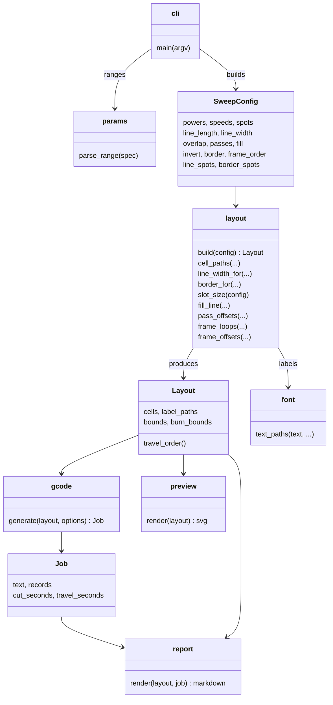

# laser-sweep

Generates GRBL gcode that burns a parameter sweep for a UV laser: spot size
against feed rate against power, drawn as lines of a settable width.

Output matches the dialect of the known good `laser-kinda-working.gcode`
(`G21`/`G90`, `M4` dynamic power, `S` on the first cut move of each path).

## Usage

```sh
uv run laser-sweep --power 200:800:4 --speed 300:900:4 --spot 0.05,0.1,0.15
```

Writes three files next to `--output` (default `out/sweep.gcode`):

| File | Purpose |
| --- | --- |
| `sweep.gcode` | the job |
| `sweep.gcode.map.md` | cell coordinates, worksheet, time estimate |
| `sweep.gcode.preview.svg` | layout check before burning |

Add `--dry-run` to print the summary without writing anything.

## Ranges

Every sweep range accepts the same forms:

| Form | Meaning |
| --- | --- |
| `300` | one value |
| `100,200,300` | explicit list |
| `100:800:8` | 8 values, linear, ends included |
| `100:800:8:log` | 8 values, logarithmic |
| `100:800:+100` | steps of 100 |

## Reading the coupon

Each spot size gets its own block, labelled `d<spot>` above its top left
corner. Inside a block, power (`P`) labels the rows and increases upwards,
feed rate (`F`) labels the columns and increases to the right. Labels are
burned with the middle of each range unless `--label-power` /
`--label-speed` say otherwise.

Line width is filled with parallel passes stepped over by the spot size, so
the pass centers span `width - spot` and the beam radius covers the rest.
`--overlap` shrinks the step, `--fill unidirectional` lifts the beam between
passes instead of turning it around.

A solid line is a stroked centerline: `--line-width` is burned exactly, but
the ends run half a spot past `--line-length`.

## Sizing in spots

`--line-spots N` replaces `--line-width` and `--border-spots N` replaces
`--border`, sizing them from each block's own spot instead of in millimetres.
Every block then burns the same number of passes, and the physical size scales
with the spot.

```sh
uv run laser-sweep --line-spots 4 --spot 0.05,0.1,0.15
```

This measures the beam directly. `N` passes stepped by an assumed spot `d`
burn a line of `(N - 1) * d + d_true`, so:

```
d_true = measured_width - (N - 1) * d
```

Inverted, `--border-spots N` holds the island at a fixed width while the
frame scales, and the island comes out `width - (d_true - d)` wide. `N` must
be at least 1, since a frame thinner than the beam cannot be cut.

Blocks stay on a common grid: the pitch follows the largest block, so cells
line up across blocks even when they differ in size.

## Inverted lines

`--invert` swaps the burn: each cell clears a `--border` frame around an
uncut island, and `--line-width` becomes the width left standing. This is the
isolation routing case, where the feature that matters is the copper that
survives.

```sh
uv run laser-sweep --invert --line-width 0.3 --border 0.4 --spot 0.05,0.1,0.15
```

The frame is cut as concentric closed loops. The innermost loop sits half a
spot outside the island, so its beam edge stops on the island boundary; the
outermost stops half a spot inside the border, so the cleared band is exactly
`--border` wide. `--frame-order outside-in` reverses the loops. `--fill` does
not apply.

A border narrower than the widest spot in the sweep is refused: that frame
cannot be cut without eating into the island.

## Backlash

`--approach N` rapids to a point `N` mm below and left of every path start
and then rapids into it, so both axes enter each path already moving in the
positive direction. Cell paths begin with a +X move and then a +Y move, so
the sides that define the line or island never follow a direction reversal
and backlash stays out of the measured width. Leave `N` mm of travel free
below and left of the sweep.

```sh
uv run laser-sweep --invert --line-width 0.2 --border-spots 1 --approach 2
```

`--backlash X[,Y]` compensates a measured lost motion instead. The emitter
tracks which way each axis last moved and, after a reversal, shifts every
following coordinate by the backlash so the head lands on the geometry. A
reversal inside a cut is crossed with the beam off: the path ends, a rapid
moves the motor through the dead band while the head stays put, and the cut
resumes with its own `S` and `F`. The job opens with a short rapid to the
origin and then up and right, so both axes start in the positive state, which
is the reference: set the work zero after jogging into it from below left.
Commanded coordinates reach one backlash below and left of the geometry.

```sh
uv run laser-sweep --invert --line-width 0.2 --border-spots 1 --approach 2 --backlash 0.2,0.15
```

Measure the values from a coupon burned with `--approach`: the island length
gives X and the open bottom left corner gives Y, both plus the true spot.

## Safety

`--s-max` (default 1000) bounds the power range. `--fit WxH` refuses to write
a sweep larger than the given area. Check the preview SVG and the extent in
the summary before running the job.

## Architecture



## Development

```sh
uv run pytest
```
