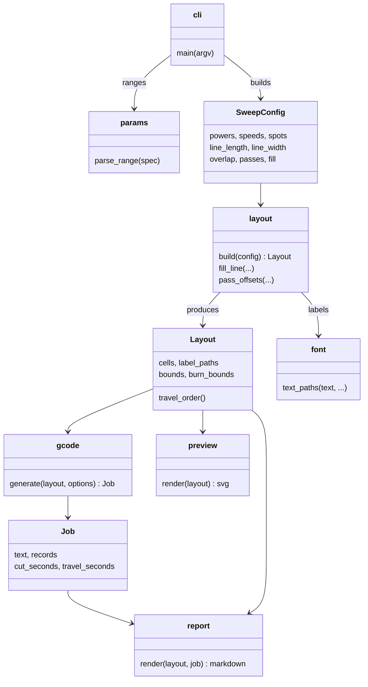

# laser-sweep

Generates GRBL gcode that burns a parameter sweep for a UV laser: spot size
against feed rate against power, drawn as lines of a settable width.

Output matches the dialect of the known good `laser-kinda-working.gcode`
(`G21`/`G90`, `M4` dynamic power, `S` on the first cut move of each path).

## Usage

```sh
uv run laser-sweep --power 200:800:4 --speed 300:900:4 --spot 0.05,0.1,0.15
```

Writes three files next to `--output` (default `out/sweep.gcode`):

| File | Purpose |
| --- | --- |
| `sweep.gcode` | the job |
| `sweep.gcode.map.md` | cell coordinates, worksheet, time estimate |
| `sweep.gcode.preview.svg` | layout check before burning |

Add `--dry-run` to print the summary without writing anything.

## Ranges

Every sweep range accepts the same forms:

| Form | Meaning |
| --- | --- |
| `300` | one value |
| `100,200,300` | explicit list |
| `100:800:8` | 8 values, linear, ends included |
| `100:800:8:log` | 8 values, logarithmic |
| `100:800:+100` | steps of 100 |

## Reading the coupon

Each spot size gets its own block, labelled `d<spot>` above its top left
corner. Inside a block, power (`P`) labels the rows and increases upwards,
feed rate (`F`) labels the columns and increases to the right. Labels are
burned with the middle of each range unless `--label-power` /
`--label-speed` say otherwise.

Line width is filled with parallel passes stepped over by the spot size, so
the pass centers span `width - spot` and the beam radius covers the rest.
`--overlap` shrinks the step, `--fill unidirectional` lifts the beam between
passes instead of turning it around.

## Safety

`--s-max` (default 1000) bounds the power range. `--fit WxH` refuses to write
a sweep larger than the given area. Check the preview SVG and the extent in
the summary before running the job.

## Architecture



## Development

```sh
uv run pytest
```
